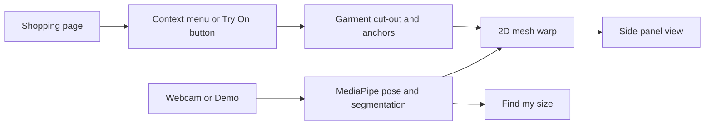

# FabStudio user guide

FabStudio is a Chrome and Edge extension (version 0.1.0) that puts a top on you from your webcam. Pose tracking and garment cut-out run in the browser with MediaPipe. Video and photos stay on your computer. The first time you start the camera, the extension downloads the body-tracking models (about 40 MB) and keeps them locally.

This guide is for people working from this source folder. A short “unzip and load” note for a pre-built package is in [INSTALL.txt](INSTALL.txt). The full source listing is in [FabStudio-source-code.md](FabStudio-source-code.md); this guide does not repeat it.

## What you need

- A Chromium browser: Chrome, Edge, or another browser that loads unpacked extensions.
- Node.js **20.19 or newer**, or **22.12 or newer**. The build uses Vite 8, which will not run on older Node versions.
- A webcam if you want a live try-on. **Demo** works without one.
- A network connection the first time the camera starts, so the pose and segmentation models can download. After that they load from a local cache.

## Install from this folder

The built extension is not in the repository. `dist/` is created when you build, and it is listed in [.gitignore](.gitignore). Load that folder, not the project root. The root `manifest.json` points at compiled files such as `background.js`, and those files exist only inside `dist/` after the build.

1. Open a terminal in this folder.
2. Install dependencies. This also copies the MediaPipe WebAssembly runtime into `public/wasm` (`scripts/copy-wasm.mjs`):

   ```bash
   npm ci
   ```

3. Build the extension. The build generates icons, bundles the app, then copies `manifest.json`, icons, and the WASM files into `dist/` (`scripts/generate-icons.mjs`, Vite, `scripts/copy-assets.mjs`):

   ```bash
   npm run build
   ```

4. In the browser, open `chrome://extensions` (Edge: `edge://extensions`).
5. Turn on **Developer mode** (top right).
6. Click **Load unpacked** and choose the `dist` folder inside this project. That folder contains `manifest.json`.
7. Optional: pin FabStudio from the puzzle-piece icon in the toolbar so you can open it without hunting through the menu.

After you change source files, run `npm run build` again, then click **Reload** on the FabStudio card at `chrome://extensions`.

Chrome warns that the extension can “read and change all your data on all websites.” That host permission (`<all_urls>` in [manifest.json](manifest.json)) is there so FabStudio can download the product photo you pick. The extension does not upload your camera or those photos.

### Commands while developing

| Command | What it does |
| --- | --- |
| `npm run dev` | Rebuilds into `dist/` whenever a source file changes. Reload the extension in the browser to see the new build. |
| `npm test` | Runs the Vitest suite (sizing and log filtering). |
| `npm run typecheck` | Type-checks the project with TypeScript. |

## Use the extension

Click the FabStudio toolbar icon. A side panel opens. The toolbar click is wired to open the panel directly (`src/background.ts`).

The panel has two tabs:

- **Try-On** is the camera view, fit controls, and size scan.
- **Garments** is the catalog: upload, pick, or remove a top.

The footer states the privacy rule used by the app: everything stays on this device.

### Start the camera

1. Click **Start camera**.
2. A normal browser tab opens and asks for the camera. Chrome does not show that prompt inside a side panel, so the extension asks on its own page (`permission.html`).
3. Click **Allow**. If the browser offers a choice, pick **Allow on every visit** (or **Allow**), not **Allow this time**. A one-time grant applies only to that tab, and the panel still cannot use the camera.
4. The tab closes and the try-on starts in the panel.

The first start downloads and caches three models: the full or lite pose landmarker, and the selfie segmentation model. Later starts load them from IndexedDB (`fabstudio-extension`).

**Demo** draws a waving test figure and runs the same try-on on it. Use it to check that a garment loaded, without a webcam.

**Stop** releases the camera. If the camera is unplugged or another app takes it, the panel says the camera stopped and you press **Start camera** again.

### Add a garment

Tops only: T-shirts, shirts, hoodies, jackets. The catalog labels also include dresses, trousers, and other, but the cut-out is built for a top.

Three ways to add one:

1. On a shopping page, right-click a product photo and choose **Try on with FabStudio**.
2. Hover a large product photo. A **Try On** button appears on images that are at least about 150 pixels on each side, are not extremely wide or tall, and are not inside the site header, nav, or footer (`src/content.ts`).
3. Open the **Garments** tab and click **+ Upload garment**. The empty Try-On screen has the same upload control.

Photos that work best:

- A model standing straight, facing the camera, wearing the top.
- The top alone on a plain background.
- A PNG that is already transparent around the garment.

The panel then reports how it prepared the photo: it cut the top out of a model photo, removed the background, or used the photo’s existing transparency. Any extra notes (rough edges, a crop above the hips, a narrow hem) appear in the same notice. The prepared PNG and its anchor points are stored in IndexedDB. Photos are scaled so the long side is at most 1024 pixels.

If the side panel is closed when you pick an image, the toolbar icon shows a badge **1**. Click the icon. The panel opens and takes the waiting garment.

Select a thumbnail under the camera to switch tops. On the Garments tab, click a card to select it and return to Try-On, or click **×** to remove it.

### Stand so tracking can see you

For try-on, stand about **1.5–2.5 m** from the camera so your head, shoulders, and hips are in view. Face the camera. The chip above the controls shows:

| Label | Meaning |
| --- | --- |
| Tracking | A pose is locked. The meter is how confident that lock is. |
| Re-acquiring… | The pose dropped for a moment and the last good pose is being held. |
| Looking for you… | No pose yet. Step into frame, or move closer so the shoulders are visible. |
| Camera off | The camera is stopped. |

The other chip is frames per second. A **Your size** chip appears after a successful size scan.

**Mirror** flips the view to match a mirror. It does not change the tracking math.

The camera menu lists devices after the camera has been allowed. **Default camera** uses the user-facing camera.

### Adjust the fit

Open **Settings**.

**Fit**

- **Size** scales the garment (0.70–1.40).
- **Width** stretches it sideways (0.70–1.40).
- **Shift** moves it up or down.
- **Reset** restores the default fit.

**Quality**

- **Smoothing** damps jitter. Higher is steadier and a little slower to follow a fast move.
- **Fold shading** darkens the cloth where the mesh bends.
- **Occlusion** lets arms and hands draw in front of the shirt. Turn it off if the cut-out around the arms looks wrong.

**Engine**

- **Pose model**: **Full** is more accurate. **Lite** is lighter. If the browser is using a software graphics driver (SwiftShader or similar), the panel starts on Lite and CPU.
- **Inference**: **Auto** tries the GPU, then the CPU. **GPU** or **CPU** forces one. Changing these takes effect the next time you start the camera.

These choices are saved in the extension’s local storage.

### Find your size

**Find my size** estimates chest, waist, and hip from the camera and maps them onto a generic size chart. It is a body measurement, not a brand’s garment chart. Brands differ by a size or more. Compare the centimetre readings with the product’s own chart before you buy.

1. Start the camera.
2. Open **Find my size**.
3. Enter your height, between **120 and 230 cm** (or feet and inches). Height is the ruler for every other measurement. The scan button stays disabled until height is valid.
4. Choose a chart: **Men’s**, **Women’s**, or **Unisex**.
5. Choose a fit preference: **Slim**, **Regular**, or **Relaxed**. That shifts the target inside each size range. Slim aims toward the tighter end, relaxed toward the looser end.
6. Click **Start size scan**.

Wear close-fitting clothes. A baggy top makes the measurement larger. For a full scan, stand about **2–3 m** back so the camera sees you from head to feet.

The scan has two steps and takes about 10 seconds:

1. **Front.** Whole body in view, facing the camera, arms a little away from the body. Hold still while the checks turn green.
2. **Side.** Turn 90 degrees, still full length. **Skip side view** finishes with a rougher girth estimate.

If your feet stay out of frame, the panel offers **Can’t fit my feet in — quick estimate**. That uses the torso as the scale instead of your full height, and it only captures the front.

The result shows a recommended size, how often each size wins across the measurement uncertainty, and shoulder, chest or bust, waist, and hip in centimetres with a confidence label. It stays until you click **Clear result** or scan again. The chart and fit preference are saved, so changing them updates the recommendation from the same measurements.

The charts in `src/sizing/charts.ts` are typical international high-street ranges. They are not copied from any brand.

## Troubleshooting

Right-click the side panel, choose **Inspect**, open **Console**, and copy any red lines if you need to report a problem. A screenshot of the panel helps too.

On the extensions page, lines such as `INFO: Created TensorFlow Lite XNNPACK delegate` under Errors are normal log messages from the pose runtime, not a failure.

### Camera

| What you see | What to do |
| --- | --- |
| “Allow the camera in the tab that just opened.” | Use the tab FabStudio opened. Allow the camera there. The panel starts on its own when the grant succeeds. |
| “Camera access is blocked for FabStudio.” | The permission tab can open Chrome’s site settings for the extension. Set Camera to **Allow**, then click **Allow camera** again. |
| “The camera was allowed only for that tab…” | You chose **Allow this time**. Click **Allow camera** and choose **Allow on every visit**. |
| “No camera was found.” | Plug in a webcam, or pick another device in the camera menu, then start again. |
| “The camera is in use by another app…” | Close Teams, Zoom, OBS, or anything else holding the camera, then retry. |
| “Camera stopped. Reconnect and press Start camera.” | The track ended (unplugged, or another app took it). Reconnect and start again. |
| “This browser does not support camera access.” | Use a current Chrome, Edge, or other Chromium browser. |

**Allow camera** on an error banner reopens the permission tab.

### Models and graphics

| What you see | What to do |
| --- | --- |
| Stuck on “Downloading pose_full…” or a failed download | The first run needs access to Google’s MediaPipe model storage. Check the network, then start the camera again. A successful download is cached, so later runs work offline. |
| “Could not start pose tracking” | In Settings, set Inference to **CPU** and Pose model to **Lite**, reload the extension, and start the camera again. |
| An error that mentions WebGL, a lost context, or shader compilation | The GPU driver dropped the graphics context, or WebGL2 is unavailable. Close other tabs and GPU-heavy apps, then click **Retry** on the banner or reload the extension. Chrome and Edge are required; WebGL2 is not optional. |
| Low frame rate | The engine can segment less often, or switch to a lighter pose setup, and say so in its quality note. Lite + CPU is the manual version of that. |

If the graphics driver is a software renderer, FabStudio starts on the lite pose model and CPU without you changing Settings.

### Garments

| What you see | What to do |
| --- | --- |
| “Image is too small” | Use a photo whose shorter side is at least 64 pixels after it is loaded. Product thumbnails under that size are rejected. |
| “Couldn’t find a garment in this image.” | The cut-out found almost no garment pixels. Use a clearer photo: a person facing the camera, a top on a plain backdrop, or a transparent PNG. |
| “The background isn’t plain, so the cut-out may be rough.” | The backdrop was not a flat colour. A transparent PNG or a plain wall photo works better. |
| “Couldn’t see much of the top” / hem or shoulder warnings | The pose or outline was incomplete (cropped above the hips, tilted shoulders, busy scene). The garment is still saved. Check the fit sliders, or upload a straighter full-torso photo. |
| “Failed to capture garment: download failed” | The page’s image URL could not be fetched (blocked hotlink, login wall, or a non-image URL). Save the picture and use **Upload garment**. |
| Badge **1** on the icon and nothing in the panel | A capture arrived while the panel was closed. Click the icon. The badge clears when the panel opens. |
| “Could not load garment” | The saved image could not be decoded. Remove the garment and add it again. |

The on-page **Try On** button only attaches to reasonably large photos. Icons, banners, and nav images are skipped. The right-click menu **Try on with FabStudio** works on any image, including ones the button ignores.

### Size scan

| What you see | What to do |
| --- | --- |
| “Enter your height first…” | Height must be between 120 and 230 cm. The scan will not start without it. |
| Checks stay red | Step back until head and feet are in frame, face the camera, and hold still. Arms slightly away from the body help the front step. |
| Feet never fit | Use **Can’t fit my feet in — quick estimate**. The result is less precise because it does not use your full height as the scale. |
| Scan fails with no body mask | Segmentation did not see a person for several seconds. Improve the light, step into frame, and start again. Occlusion and the size scan both need the segmentation model, which is loaded with the camera. |
| Size looks wrong | Wear fitted clothes, use the side step, and treat the chart as generic. Match the centimetre numbers to the brand chart. **Scan again** replaces the saved result. |

## How the project works

FabStudio is a Manifest V3 extension. There is no server in this repository. The side panel, a background service worker, and a content script share the work.



### Extension pieces

| Piece | File | Role |
| --- | --- | --- |
| Manifest | `manifest.json` | Name, version, side panel, service worker, content script, permissions. |
| Background | `src/background.ts` | Creates the image context menu, opens the side panel on the toolbar click, and stores a pending garment. |
| Content script | `src/content.ts` | Adds the hover **Try On** button and sends the image URL to the background script. |
| Permission tab | `src/permission.ts` | Asks for the camera on a normal tab, then tells the panel the grant succeeded. |
| Side panel | `src/SidePanelApp.tsx`, `src/sidepanel.tsx` | Camera, catalog, settings, and the live view. |
| Size UI | `src/SizePanel.tsx` | Height, chart, fit preference, scan progress, and the recommendation. |
| Storage | `src/lib/store.ts` | IndexedDB database `fabstudio-extension`: garments, PNG blobs, and cached models. |
| Build | `vite.config.ts`, `scripts/` | Bundles the HTML entries and scripts, strips MediaPipe’s usage logger, copies WASM and the manifest into `dist/`. |

Permissions in the manifest:

- `sidePanel` opens the try-on UI.
- `contextMenus` adds **Try on with FabStudio**.
- `storage` holds the garment that is waiting to be imported.
- `activeTab` is declared for the current tab.
- Host access to all URLs lets the panel `fetch` a product image.

MediaPipe’s own usage logger is patched out at build time (`vite.config.ts`), so the extension does not POST telemetry to Google. The model files themselves still download from Google storage on first use.

### From a product photo to a garment

`src/lib/garmentPrep.ts` accepts a photo and returns a transparent PNG plus anchor points (neck, shoulders, hips, and sleeve points when it can see them). It picks one of three paths:

- **Person.** A pose is detected and the head is where a face should be. The segmentation “clothes” class supplies the pixels. Trousers are split off by colour, anything above the collar is dropped, and the largest remaining piece is kept. Anchors come from the pose.
- **Transparent.** The file already has a meaningful transparent background. Only the anchors are estimated.
- **Background.** No reliable person. The plain backdrop is flood-filled from the image border, and anchors are estimated from the silhouette.

If almost none of the image is garment, preparation fails and nothing is saved. Otherwise the PNG and a garment record (name, category, sleeve type, anchors, mesh settings) go into IndexedDB.

### Each video frame

`src/shared/tryon/engine.ts` runs on the main thread, because the GPU pose delegate and the WebGL view share the graphics stack:

1. Read a frame from the webcam, or from the synthetic scene in Demo (`src/shared/tracking/synthetic.ts`).
2. Run the pose landmarker (`src/lib/vision-ext.ts`). One person is tracked.
3. Run selfie segmentation on some frames (clothes, skin, hair, background). If the frame rate drops, segmentation runs less often. The engine can also fall back to a lighter pose configuration.
4. Smooth the landmarks (`src/shared/tracking/oneEuro.ts`, `src/shared/tracking/bodyTracker.ts`). If the hips are not visible, they are estimated and the hem is less reliable.
5. Deform a 2D mesh of the garment so its anchors follow the shoulders, hips, and arms (`src/shared/render/garmentMesh.ts`, `src/shared/render/deform.ts`).
6. Draw the camera and the warped garment with WebGL (`src/shared/render/renderer.ts`). With occlusion on, arm capsules are painted so limbs can cover the cloth (`src/shared/render/occlusion.ts`).

The result is a photograph bent onto your outline. There is no back view and no cloth simulation.

### Size estimation

`src/sizing/scan.ts` watches the same landmarks and segmentation mask. It waits until you are steady and in frame, collects front samples, then side samples. `src/sizing/measure.ts` turns those samples into centimetres using your height (or the torso, in the quick estimate). `src/sizing/fit.ts` scores those measurements against the chart. Being larger than a size is penalised more than being smaller. The percentages on the result are how often each size wins when the measurement error is taken into account. They are a stability check, not a validated accuracy figure.

## Limits of this build

- The try-on is a 2D warp. Sleeves follow the arms when the anchors exist, but cloth does not drape, and there is no back or side garment view.
- It is aimed at tops. A dress or trousers photo will not get a dedicated pipeline.
- The toolbar icon is a generated placeholder.
- Size charts are generic. They are a starting point next to the brand’s own chart.
- Developer mode and **Load unpacked** are required. This folder is not a Chrome Web Store package.

## Where data lives

| Data | Where | Cleared by |
| --- | --- | --- |
| Garment records and PNGs | IndexedDB `fabstudio-extension` | Removing a garment in the panel, or clearing the extension’s site data |
| Pose and segmentation models | Same database, after the first download | Clearing extension site data (the next camera start downloads them again) |
| Fit sliders, camera, mirror, pose model, inference | `localStorage` keys prefixed with `fabstudio.` | Clearing extension site data |
| Height, chart, fit preference, last size result | `localStorage` | **Clear result** for the scan, or clearing site data |
| Garment waiting to be imported | `chrome.storage.local` (`pendingGarment`) | Opening the panel, which consumes it |

Nothing in this pipeline uploads the camera frames or the garment images.
